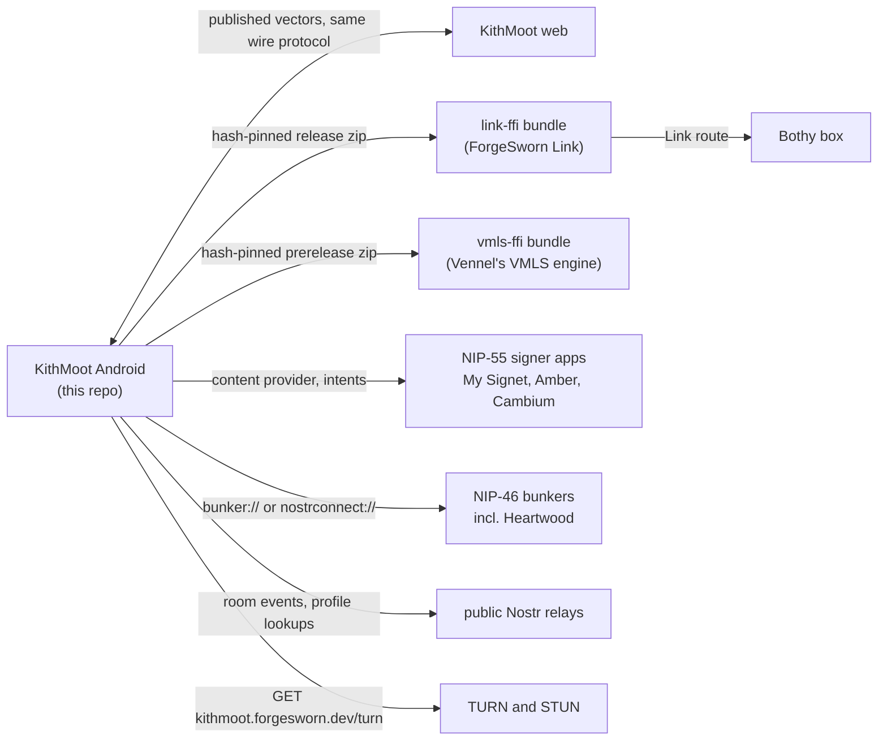

# Where KithMoot Android fits

KithMoot Android is a native Kotlin client for the KithMoot protocol: rooms, chat and calls over Nostr, with one person present on several devices as a single participant. It is the second, independent implementation, written against the published interop vectors rather than the TypeScript reference client's source ([`forgesworn/kithmoot`](https://github.com/forgesworn/kithmoot)). This page lists its direct neighbours and the exact interface to each; each neighbour's own repository is the authority for its side. For what the app itself implements, read the [README](../README.md).

| Neighbour | Relationship | Interface | Status |
| --- | --- | --- | --- |
| ForgeSworn Link (`link-ffi`) | Transport library for a paired Bothy. `relay/LinkTransport.kt` and the cadence and witness routes load `dev.forgesworn.link.ffi`. | Prebuilt bundle (`liblink_ffi.so` for arm64-v8a and x86_64, plus the UniFFI Kotlin binding) from the public forgesworn-link prerelease `android-ffi-eaec394`, fetched by `scripts/fetch-link-bridge.sh`. `scripts/prepare-link-bridge.py` refuses any archive, source commit, file set, ABI, minimum SDK, size or digest other than the reviewed one and unpacks to `app/build/link-bridge`. The URL is transport only. No `:app` task starts without it. See [link-android-bridge.md](link-android-bridge.md). | Built. Release builds carry arm64-v8a only |
| Vennel's VMLS engine (`vmls-ffi`) | MLS engine and restore-witness coordinator behind the MLS vault in `app/.../mls/`. Compiled into every build; MLS rooms stay an opt-in preview. | Same pattern: `scripts/fetch-vmls-ffi.sh` fetches `vmls-ffi-android.zip` from this repository's prerelease `vmls-ffi-android-5b3eb5f`; `scripts/prepare-vmls-ffi.py` pins the archive SHA-256, source commit, file set and every file hash. Vennel's repository is private, so a reviewed build is republished here byte for byte. See [vmls-ffi-android.md](vmls-ffi-android.md). | Built; production MLS remains opt-in |
| Signer apps (NIP-55) | Sign-in with the key off the phone: My Signet, Amber, Cambium, or anything answering `nostrsigner:` intents. A key held in a Heartwood signs through Cambium. | Signs through the signer's content provider once approved, falls back to the intent. A pasted `nsec` is refused. Cambium also carries Heartwood rendezvous provisioning (`heartwood_provision_rendezvous`, see the README). | Built |
| Bunkers (NIP-46) | Remote signers, a Heartwood included. | A pasted `bunker://` link, or a `nostrconnect://` invitation approved in My Signet in a browser; the client pairs over a relay. Saved: the bunker link and this phone's NIP-46 client key. Signet must stay open to answer. | Built |
| Bothy: sheltered rooms | A paired box can carry a persistent direct-message room. | **Connect Bothy** pairs a Link route; the creator signs active and pre-signed revoked circle grants with the signer and publishes them only through the keeper-authenticated route; the relay set cuts over after `OK true`. A sheltered relay must answer NIP-42 AUTH (kind 22242) before any `REQ` or `EVENT`. Client side of Vennel's G3 to G5 contracts. See [relay-authentication.md](relay-authentication.md). | Built |
| Bothy: quiet cadence | A paired box can send a phone device's fixed quiet-room cadence for a bounded window. | Control requests over the Link bridge, journalled before sending; scheduled traffic still uses the dead-drop format on public WSS relays. Leases run up to twelve hours and renew. See [quiet-cadence.md](quiet-cadence.md). | Built, with fixture evidence only; physical background and battery acceptance remains. This client joins quiet rooms but cannot start one |
| Bothy: box discovery | Check what a contact's box advertises. | `discovery/BoxDiscovery.kt` verifies the keeper claim and the box-signed status against the contact card's pinned Link identity; opt-in per box with Check and Stop. Shares `box-discovery.json` with the web client. See [box-discovery.md](box-discovery.md). | Built. Verified against shared and Vennel-harness vectors; no daemon-issued events or physical-device interoperability yet |
| KithMoot web | Same protocol, independent implementation. No shared code. | `protocol/src/test/resources/kithmoot-vectors.json` is a verbatim copy of the published vectors and is never hand-edited; `box-discovery.json` is copied byte for byte; web-made fixtures (`persistent-group-web.json`, `contact-book-web.json`) check interop. `scripts/prepare-browser-call-interop.mjs` builds the web Peer for call tests. | Built. This client implements a subset, listed under "What is not here" in the README |
| Public Nostr relays | Carry room events, signalling, account records and profile lookups. | A room's own relays come first and are never cut; the device's relays fill the rest, up to sixteen; profile lookups use public profile relays. NIP-42 AUTH is mandatory on a sheltered relay and applies to a public relay only after the person confirms **Use signed-in account** for it. | Built |
| TURN and STUN | Calls run device to device; a relay is used when a pair cannot connect. | A call with no relay of its own asks `https://kithmoot.forgesworn.dev/turn` for a short-lived login within four seconds (`media/DefaultTurn.kt`; the lease must be 3,600 to 86,400 seconds and the addresses must name that host) and goes on with STUN alone if it fails. Default STUN is Google's and Cloudflare's public servers (`-Pkithmoot.defaultStun=` changes it per build); Settings → Connections sets a different STUN server. | Built |

## Gradle modules

- `:protocol`: plain JVM, no Android dependencies. Crypto (BIP-340, NIP-44 v2), events, rooms, credentials, roster, signalling, access, TURN and the VMLS leaf-binding reader. It runs the vectors.
- `:app`: the Android app. Relay pool, room session, WebRTC, storage, Compose UI, and the glue to the link-ffi and vmls-ffi bundles.
- `:g5-signer`: a NIP-55 fixture signer with deterministic keys, never a real identity. Test-only, driven by `G5ProductJourneyTest`.
- `:mesh-radio`: the native BLE engine behind Nearby room routes ([nearby-room-routes.md](nearby-room-routes.md)), compiled from `forgesworn/capacitor-mesh-ble` sources pinned and hash-checked by `scripts/prepare-mesh-radio.py`; upstream code is never run.
- `:sdk-signet-contacts`: the unmodified public `signet-contacts-kotlin` core, built from the archive and commit recorded in `sdk-signet-contacts/vendor/source.json` and digest-checked before compilation. Backs Contacts ([signet-contact-messaging.md](signet-contact-messaging.md)).

## What this repo leaves to others

- Building Link and the VMLS engine. It consumes reviewed binaries and never rebuilds them.
- Holding keys. Signers do; the app saves a package name or a bunker link, not a key.
- What a Bothy stores and serves beyond the routes above.
- The protocol definition. The published vectors and the web client's documents set it.
- Running relays, TURN and STUN.

## Not built yet

- The web client's `fsl://` encrypted file references to a Bothy: nothing in `app/src/main` handles them.
- Starting a quiet room, forwarders, peer assist and end-to-end encrypted media ([README](../README.md), "What is not here").
- Physical-device acceptance of Bothy journeys: [quiet-cadence.md](quiet-cadence.md) and [box-discovery.md](box-discovery.md) record emulator and fixture evidence only.

Checked against kithmoot-android d387de4f and kithmoot cede413c on 6 November 2026.
